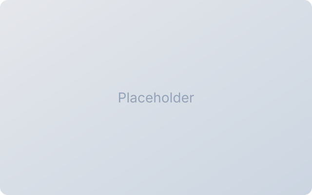
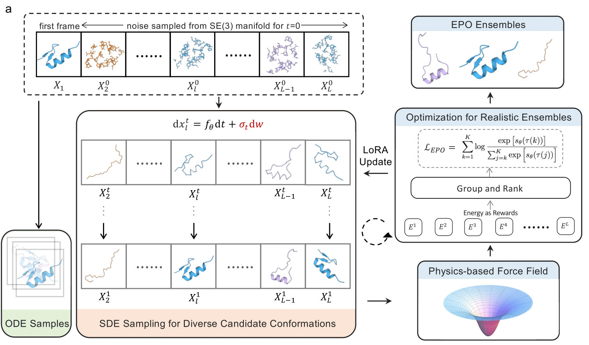
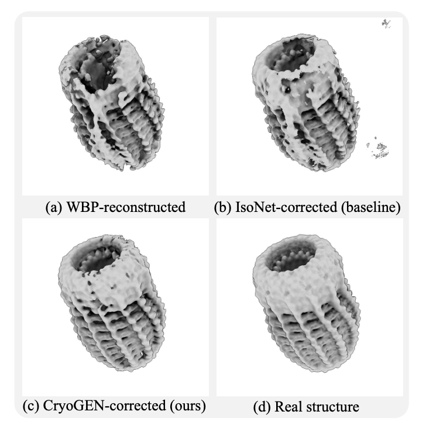
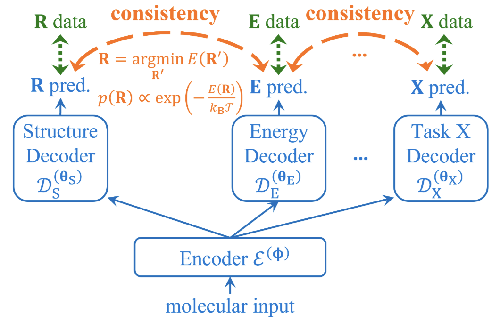

I'm a Ph.D. student at the School of Computing, National University of Singapore, advised by Prof. Yatao Bian in the Blue Whale Lab. I work on cross-domain generative models, molecular languages and reasoning for AI for Science. Before that, I was a Researcher at Beijing Academy of Artificial Intelligence (BAAI) supervised by Qiwei Ye, and a research intern at Microsoft Research AI4Science supervised by Dr. Chang Liu from Aug 2023 to Jun 2024. I also worked on the post-training of ZGCM-1 with the ZGCM Team, mentored by Jiyan He. I received my B.S. from University of Science and Technology of China advised by Prof. Zhonghuai Hou.

---

## News

 2026‑10     Our preprint [STAMP](https://arxiv.org/abs/2610.18438), a topology-aware molecular language, is on arXiv 

 2026‑09     [ZGCM‑1](https://arxiv.org/abs/2609.13356), a fully open 7B foundation model for math and agentic search, was released 

 2026‑07     Our preprints [SinAE](https://arxiv.org/abs/2607.12380) and [Chemical Chain‑of‑Thought](https://arxiv.org/abs/2607.20935) are on arXiv 

 2025‑11     Our work EPO was accepted at [AAAI 2026](https://aaai.org/conference/aaai/aaai-26/) 

 2025‑03     Our work CryoGEN was accepted at [ICLR 2025](https://iclr.cc/Conferences/2025) 

 2024‑09     Our work Physical Consistency MTL was accepted at [NeurIPS 2024](https://neurips.cc/Conferences/2024) 

 2024‑09     Our work Neural P&^3&M was accepted at [NeurIPS 2024](https://neurips.cc/Conferences/2024) 

---

## Selected Publications

<ol class="pubs">
  <li class="pub-item">
    
    

      
SinAE: A Single‑Architecture Flow‑Matching Autoencoder for Cross‑Domain Atomic Systems

      
<em>Yuxuan Ren, Fan Yang, Jianhua Yao, Yatao Bian</em>.

      
<em>arXiv preprint</em>, 2026

      
<a href="https://arxiv.org/abs/2607.12380">PDF</a> <a href="https://github.com/BlueWhaleLab/SinAE">Code</a>

    

  </li>
  <li class="pub-item">
    
    

      
STAMP as a Topology‑Aware Molecular Language for Fragment‑Level Learning and Editing

      
<em>Yuxuan Ren, Jiatong Li, Ziqiao Meng, Yatao Bian</em>.

      
<em>arXiv preprint</em>, 2026

      
<a href="https://arxiv.org/abs/2610.18438">PDF</a> <a href="https://github.com/YuX-Ren/STAMP_V1">Code</a>

    

  </li>
  <li class="pub-item">
    
    

      
ZGCM‑1: A Fully Open and Extremely Efficient Foundation Model for Math and Agentic Search

      
<em>ZGCM Team (including Yuxuan Ren)</em>.

      
<em>arXiv preprint</em>, 2026

      
<a href="https://arxiv.org/abs/2609.13356">PDF</a>

    

  </li>
  <li class="pub-item">
    
    

      
EPO: Diverse and Realistic Protein Ensemble Generation via Energy Preference Optimization

      
<em>Yuancheng Sun, Yuxuan Ren, Zhaoming Chen, Xu Han, Kang Liu, Qiwei Ye</em>.

      
<em>AAAI</em>, 2026

      
<a href="https://ojs.aaai.org/index.php/AAAI/article/view/37076">PDF</a>

    

  </li>
  <li class="pub-item">
    
    

      
CryoGEN: Energy‑based Cryo‑ET Reconstruction

      
<em>Yunfei Teng†, Yuxuan Ren†, Kai Chen, Xi Chen, Zhaoming Chen, Qiwei Ye</em>.

      
<em>ICLR</em>, 2025

      
<a href="https://iclr.cc/virtual/2025/poster/27980">PDF</a>

    

  </li>
  <li class="pub-item">
    
    

      
Physical Consistency Bridges Heterogeneous Data in Molecular Multi‑Task Learning

      
<em>Yuxuan Ren†, Dihan Zheng†, Chang Liu*, Peiran Jin, Yu Shi, Lin Huang, Jiyan He, Shengjie Luo, Tao Qin, Tie-Yan Liu.</em>, et al.

      
<em>NeurIPS</em>, 2024

      
<a href="https://neurips.cc/virtual/2024/poster/95877">PDF</a>

    

  </li>
</ol>

---
<!-- 
## Projects

- SFM: Physics‑consistent molecular MTL base model. [Code]() · [Paper]()
- Neural P3M for GNNs. [Code]() · [Paper]()
- OpenCryo / CryoGEN. [Project]() · [Paper]() -->
