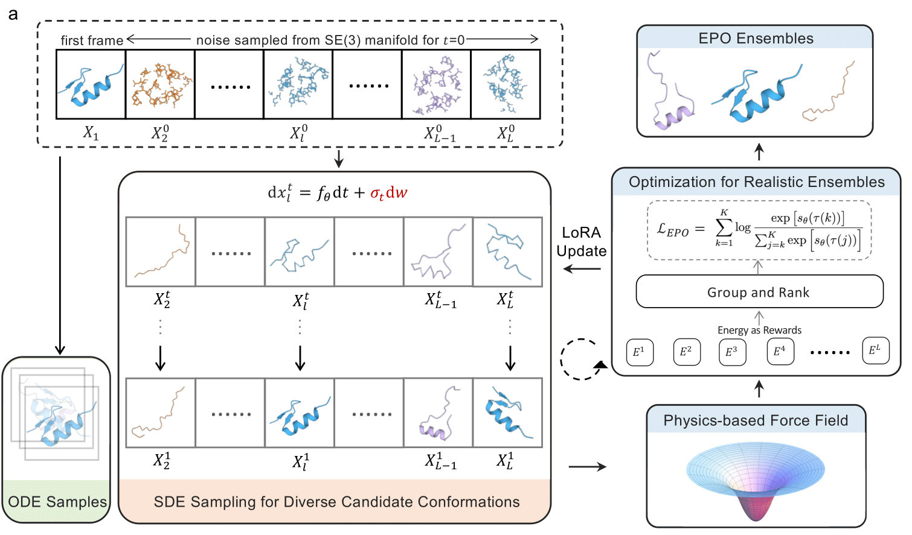
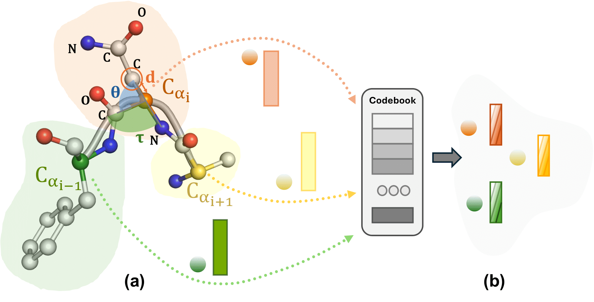
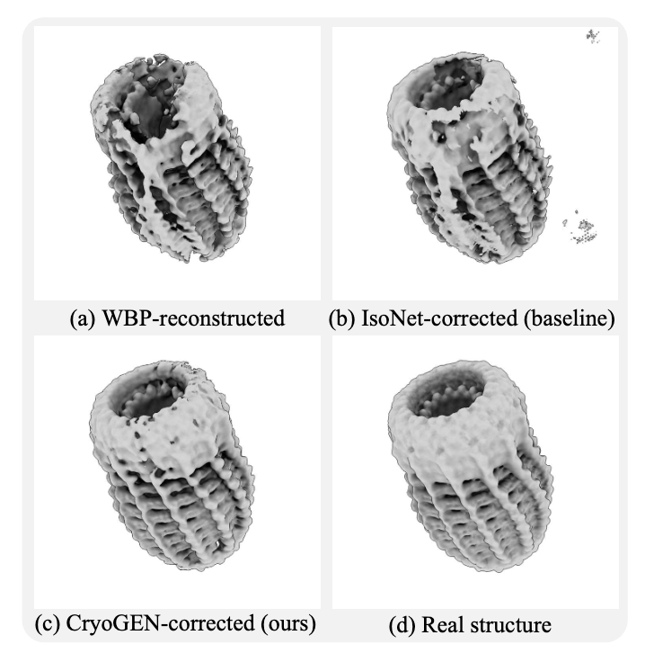
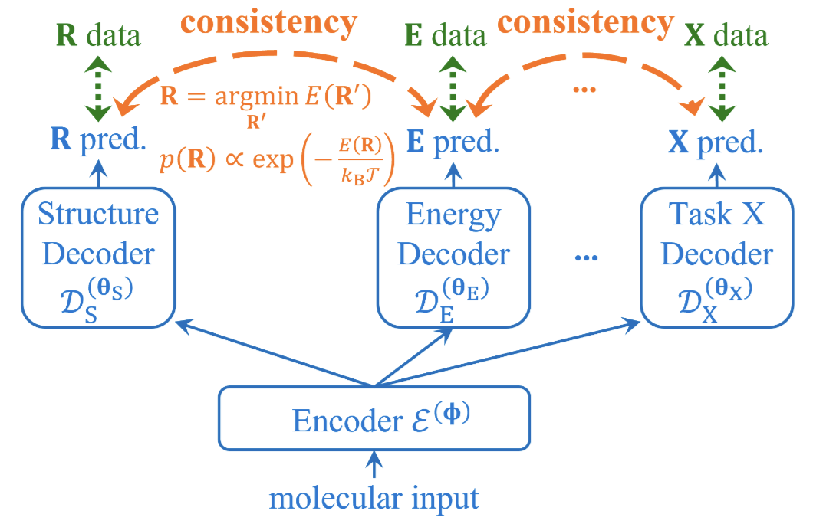
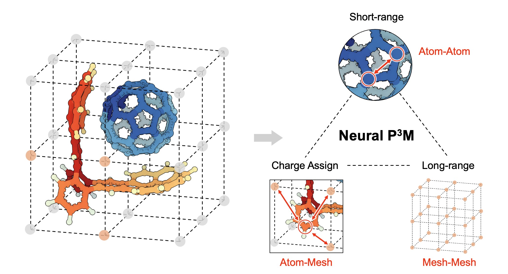

<ol class="pubs">
  <li class="pub-item">
    
    

      
STAMP as a Topology‑Aware Molecular Language for Fragment‑Level Learning and Editing

      
<em>Yuxuan Ren, Jiatong Li, Ziqiao Meng, Yatao Bian</em>.

      
<em>arXiv preprint</em>, 2026

      
<a href="https://arxiv.org/abs/2610.18438">PDF</a> <a href="https://github.com/YuX-Ren/STAMP_V1">Code</a>

    

  </li>
  <li class="pub-item">
    
    

      
ZGCM‑1: A Fully Open and Extremely Efficient Foundation Model for Math and Agentic Search

      
<em>ZGCM Team (including Yuxuan Ren)</em>.

      
<em>arXiv preprint</em>, 2026

      
<a href="https://arxiv.org/abs/2609.13356">PDF</a>

    

  </li>
  <li class="pub-item">
    
    

      
Chemical Chain‑of‑Thought Functions as a Hallucination‑Prone Molecular Scratchpad

      
<em>Jiatong Li, Yuxuan Ren, Weida Wang, Xiao‑Yong Wei, Yatao Bian</em>.

      
<em>arXiv preprint</em>, 2026

      
<a href="https://arxiv.org/abs/2607.20935">PDF</a>

    

  </li>
  <li class="pub-item">
    
    

      
SinAE: A Single‑Architecture Flow‑Matching Autoencoder for Cross‑Domain Atomic Systems

      
<em>Yuxuan Ren, Fan Yang, Jianhua Yao, Yatao Bian</em>.

      
<em>arXiv preprint</em>, 2026

      
<a href="https://arxiv.org/abs/2607.12380">PDF</a> <a href="https://github.com/BlueWhaleLab/SinAE">Code</a>

    

  </li>
  <li class="pub-item">
    
    

      
EPO: Diverse and Realistic Protein Ensemble Generation via Energy Preference Optimization

      
<em>Yuancheng Sun, Yuxuan Ren, Zhaoming Chen, Xu Han, Kang Liu, Qiwei Ye</em>.

      
<em>AAAI</em>, 2026

      
<a href="https://ojs.aaai.org/index.php/AAAI/article/view/37076">PDF</a>

    

  </li>
  <li class="pub-item">
    
    

      
Constraint Decoupled Latent Diffusion for Protein Backmapping

      
<em>Xu Han, Yuancheng Sun, Kai Chen, Yuxuan Ren, Kang Liu, Qiwei Ye</em>.

      
<em>JCTC</em>

      
<a href="https://pubs.acs.org/doi/pdf/10.1021/acs.jctc.5c01364?ref=article_openPDF">PDF</a>

    

  </li>
  <li class="pub-item">
    
    

      
CryoGEN: Energy‑based Cryo‑ET Reconstruction

      
<em>Yunfei Teng†, Yuxuan Ren†, Kai Chen, Xi Chen, Zhaoming Chen, Qiwei Ye</em>.

      
<em>ICLR</em>, 2025

      
<a href="https://iclr.cc/virtual/2025/poster/27980">PDF</a>

    

  </li>
  <li class="pub-item">
    
    

      
Physical Consistency Bridges Heterogeneous Data in Molecular Multi‑Task Learning

      
<em>Yuxuan Ren†, Dihan Zheng†, Chang Liu*, Peiran Jin, Yu Shi, Lin Huang, Jiyan He, Shengjie Luo, Tao Qin, Tie-Yan Liu.</em>, et al.

      
<em>NeurIPS</em>, 2024

      
<a href="https://neurips.cc/virtual/2024/poster/95877">PDF</a>

    

  </li>
  <li class="pub-item">
    
    

      
Neural P3M: Long‑Range Interaction Modeling Enhancer for Geometric GNNs

      
<em>Yusong Wang†,  Chaoran Cheng†,  Shaoning Li†,  Yuxuan Ren,  Bin Shao,  Ge Liu,  Pheng-Ann Heng,  Nanning Zheng</em>.

      
<em>NeurIPS</em>, 2024

      
<a href="https://neurips.cc/virtual/2024/poster/93679">PDF</a>

    

  </li>
</ol>
